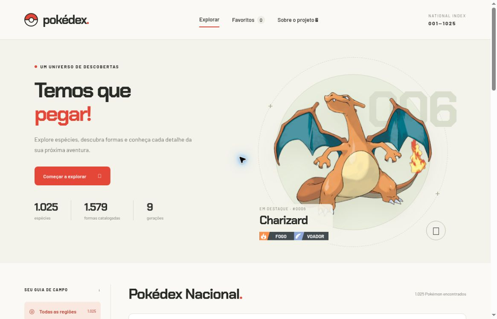
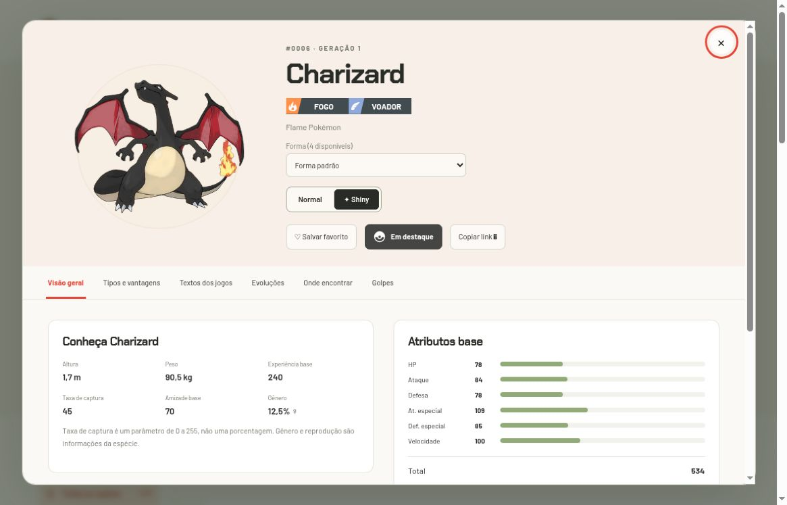
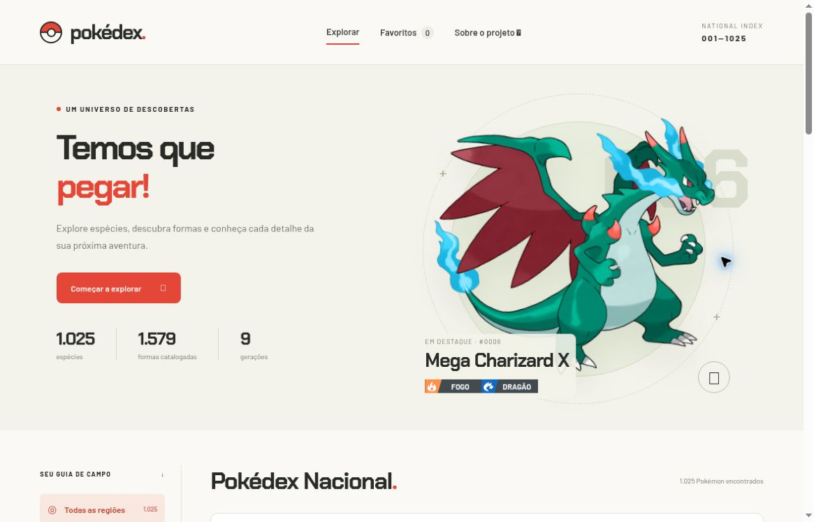

# Pokédex · Temos que pegar!

**Uma Pokédex de fã, feita por Luigi Scofano de Araujo para outros fãs de Pokémon.**

Explore espécies, descubra formas e conheça cada detalhe da sua próxima aventura.

[](https://github.com/luigiscofano/Pokedex/actions/workflows/ci.yml)

[Explorar no navegador · acesso público](https://pokedex-luigi-explorer.luigiscofano.chatgpt.site) · [Como executar](#como-executar) · [Funcionalidades](#funcionalidades-em-imagens) · [Documentação](docs/README.md) · [Contribuir](CONTRIBUTING.md)



*Página inicial da versão 1.3.2, capturada no aplicativo real. O site está aberto ao público desde 03/11/2026; o código também pode ser executado localmente.*

A interface usa **Chakra Petch nos títulos e na marca** e **Barlow nos textos, controles e rótulos de tipos**. As capturas abaixo mostram essa identidade; a fonte do texto Markdown no GitHub é definida pela própria plataforma.

## O que este projeto faz

A Pokédex reúne **1.025 espécies nacionais, 1.351 variedades e 1.579 formas catalogadas** em uma aplicação web. É possível pesquisar por nome ou número, comparar formas, alternar imagens Normal/Shiny, consultar atributos e tipos, explorar famílias evolutivas e procurar textos, encontros e golpes por jogo.

O repositório também preserva o **exercício Java original de 2023**, que começou com uma classe `Pokemon`, tipos enumerados e uma demonstração de objetos e coleções. Hoje há duas partes independentes: o site em `web/` e o exercício de terminal em `src/`. Você pode usar uma sem executar a outra.

## Qual problema resolve

Uma espécie pode ter formas com atributos diferentes, descrições que variam entre jogos, vários caminhos evolutivos e maneiras distintas de aprender golpes. Consultar essas informações sem distinguir espécie, forma e versão produz respostas incompletas.

O projeto reúne essas consultas em uma única interface e mantém o contexto de cada registro. A proposta é tornar a exploração agradável, preservar a origem das informações e mostrar quando a base não tem uma resposta.

## Funcionalidades em imagens

As capturas são reais. Cada seção abaixo aponta para um guia de uso e para a área técnica correspondente. A [galeria](docs/imagens/README.md) registra versões e contexto, incluindo imagens históricas.

### 1. Catálogo, pesquisa e filtros

Pesquise por nome, número nacional, `#0025`, zeros à esquerda ou nome de forma. A busca ignora acentos: `flabebe` encontra Flabébé. Combine geração da espécie, tipo, categoria, favoritos e inclusão de formas; ordene por número, nome ou soma dos atributos base.

O catálogo começa com 24 cartões e carrega mais 24 por ação. A soma de atributos ajuda a comparar valores base, mas não prevê o resultado de uma batalha.


*Charizard padrão, Mega X, Mega Y e Gigantamax aparecem como entradas distintas quando Incluir formas está ativo. Todas pertencem à mesma espécie nacional.*

[Guia do catálogo](docs/usuario/catalogo/README.md) · [Filtros e regras](web/js/domain.js)

### 2. Formas alternativas e aparência shiny

A seleção de forma muda o registro consultado. A alternância **Normal/Shiny** muda a aparência das imagens e acompanha catálogo, destaque, fichas e evoluções. A preferência é preservada em links e não cria um segundo favorito para a mesma forma.



*Captura da versão 1.3.2: shiny e faixas com ícones vetoriais, cores vivas e nomes legíveis.*

Formas cosméticas usam sprites específicos quando disponíveis. Se a fonte não fornece uma imagem shiny utilizável, a interface avisa; não apresenta a imagem normal como se fosse shiny.

[Formas e shiny](docs/usuario/formas-e-shiny/README.md) · [Seleção e cache de imagens](web/js/data.js)

### 3. Visão geral, atributos e tipos

Cada ficha reúne tipos em faixas escuras com símbolos vetoriais, cores vivas e nomes em maiúsculas, dimensões, habilidades normais e ocultas, atributos base, EVs concedidos, grupos de ovos e parâmetros de captura/reprodução. Os valores pertencem à variedade selecionada: Mega Charizard X, por exemplo, tem Fogo/Dragão e atributos diferentes da forma padrão.

A aba Tipos separa fraquezas, resistências, imunidades e melhores eficácias ofensivas dos tipos próprios.


*Charizard padrão é Fogo/Voador: recebe 4× de Pedra, ¼× de Planta e 0× de Terra na matriz moderna. As contas não incluem habilidades, itens, clima ou outras condições de batalha.*

[Como ler a ficha](docs/usuario/fichas/README.md) · [Matemática dos tipos](docs/desenvolvimento/tipos/README.md)

### 4. Textos dos jogos

Consulte descrições por versão e idioma. A interface é em português, mas os textos da franquia preservam os idiomas disponíveis na fonte. O projeto não apresenta traduções inventadas como descrições oficiais.


*Os seletores mantêm o contexto do texto. A descrição pertence à espécie e pode não diferenciar cada forma.*

[Textos e campos da ficha](docs/usuario/fichas/README.md) · [Dicionário dos dados](web/data/README.md)

### 5. Famílias evolutivas

Explore a família completa, incluindo ramificações e condições disponíveis na fonte: nível, itens, amizade, período, local, forma e restrições por grupo de versões, quando registradas.


*Trecho da família de Eevee; outros ramos ficam acima e abaixo do recorte. A navegação permite abrir as espécies relacionadas.*

[Guia das evoluções](docs/usuario/fichas/README.md) · [Condições no domínio](web/js/domain.js)

### 6. Onde encontrar

Filtre os encontros por jogo e consulte área, método, nível, chance do slot e condições. Diferentes linhas podem representar slots ou condições diferentes; não devem ser somadas sem interpretar o contexto.


*Pikachu em Red, incluindo registros de Viridian Forest. Ausência de linhas em outra ficha significa ausência de registros nesta base, não impossibilidade de obtenção.*

[Encontros e seus limites](docs/usuario/fichas/README.md) · [Cobertura da fonte](docs/FONTES.md)

### 7. Golpes por grupo de versões

Selecione o grupo de jogos e pesquise um golpe. A tabela distingue aprendizado por nível, máquina e outros métodos registrados. Um mesmo golpe pode aparecer mais de uma vez quando há métodos diferentes.


*O exemplo mostra o filtro `flame` em Scarlet Violet. A definição do golpe e o registro de aprendizado são informações relacionadas, com escopos diferentes.*

[Guia dos golpes](docs/usuario/fichas/README.md) · [Estruturas de aprendizado](web/data/README.md)

### 8. Destaque, favoritos, links e teclado

Escolha o botão grafite com Pokébola **Tornar destaque** dentro da ficha de qualquer Pokémon para trocar o Pokémon do início. A forma escolhida fica salva neste navegador; o modo shiny continua global.



Os favoritos guardam o ID da forma no navegador, sem conta. Os links podem preservar busca, geração, tipo, inclusão de formas, shiny e ficha selecionada. Aba, ordenação e filtros internos de jogos não são serializados.

Use `/` para pesquisar, Tab para percorrer controles, setas/Home/End nas abas e Escape para fechar a ficha. Há foco visível, diálogo nativo, preferência de movimento reduzido e áreas de rolagem internas para tabelas em telas estreitas.

[Favoritos e contrato dos links](docs/usuario/favoritos-e-links/README.md) · [Primeira exploração](docs/usuario/README.md)

## Como executar

### Requisitos

| Objetivo | Requisito |
| --- | --- |
| Executar, testar ou gerar o site | Node.js 20+ com npm |
| Clonar pelo terminal | Git; alternativamente, baixe o ZIP do repositório |
| Reimportar os dados, opcional | Python 3.10+ e acesso à fonte |
| Executar o exercício Java, opcional | JDK 17, como usado no CI |

**Não há dependências npm a instalar.** Os JSONs já acompanham o projeto; não é necessário executar a importação para abrir a Pokédex.

### Abrir o site localmente

```sh
git clone https://github.com/luigiscofano/Pokedex.git
cd Pokedex
npm run dev
```

Abra **http://localhost:3000**. Mantenha o terminal aberto enquanto usa o site; Ctrl+C encerra o servidor. Se baixar o ZIP, extraia-o e abra o terminal na pasta que contém `package.json`.

Se a porta estiver ocupada:

```sh
npm run dev -- --port 3001
```

Nesse caso, acesse **http://localhost:3001**. Não abra `web/index.html` diretamente por `file://`: módulos e JSONs precisam ser servidos por HTTP. Imagens e fontes externas dependem de rede; o projeto não promete funcionamento integral offline.

### Um roteiro de cinco minutos

1. Busque `#0025`, abra Pikachu e salve um favorito.
2. Limpe a busca, ative Incluir formas e procure `charizard`.
3. Compare a forma padrão e Mega Charizard X; alterne Normal/Shiny.
4. Na forma padrão, confira Pedra 4×, Terra 0× e Planta ¼×.
5. Troque jogo e idioma em Textos dos jogos; consulte encontros e golpes.
6. Abra Eevee e percorra seus oito ramos evolutivos.
7. Copie o link de uma ficha shiny e abra em outra aba.

[Problemas ao executar?](docs/solucao-de-problemas/README.md)

### Executar o Java original

Na mesma raiz do repositório, com JDK 17:

```sh
javac -encoding UTF-8 -d build/classes -sourcepath src src/Main.java
java -cp build/classes Main
```

A demonstração cria quatro objetos, aplica dano à cópia e imprime os resultados. Não é necessário compilar Java para usar o site. O [guia Java](src/README.md) explica saída, construtores, coleções e limites do modelo.

## Cobertura real dos dados

| Medida | Snapshot versionado |
| --- | ---: |
| Espécies nacionais | 1.025 |
| Variedades com atributos próprios | 1.351 |
| Formas, incluindo as padrão | 1.579 |
| Textos de Pokédex por jogo/idioma | 68.220 |
| Registros de encontros | 117.127 |
| Registros de aprendizado de golpes | 638.321 |
| Lotes de fichas | 21 |

As contagens não devem ser somadas: formas se relacionam com variedades e espécies; textos, encontros e golpes contêm registros por contexto. Shiny é aparência e não uma segunda cópia de todas as espécies na contagem.

O [manifesto](web/data/manifest.json) registra a revisão `e5b79b2e15d7c50735a945936afd4cd1cfd94eae` da PokéAPI, contagens e hashes SHA-256. O site consulta a base servida com o projeto; imagens e metadados de sprites cosméticos são externos.

### Limites de interpretação

- A cobertura é a do snapshot, não uma promessa de atualização automática para futuros jogos e formas.
- Encontros não cobrem integralmente eventos, presentes, trocas e todos os meios de obtenção.
- Taxa de captura é um parâmetro, não uma probabilidade final em porcentagem.
- Tipos usam regras modernas; não há reconstrução histórica por geração nem simulação de dano final.
- Favoritos pertencem à origem e ao perfil do navegador; não sincronizam entre dispositivos.
- Dados ausentes e imagens indisponíveis são indicados explicitamente.

[Origem e atualização](docs/dados/README.md) · [Esquema dos JSONs](web/data/README.md) · [Créditos e cobertura](docs/FONTES.md)

## Como o projeto está organizado

| Caminho | Responsabilidade | Guia |
| --- | --- | --- |
| `web/` | HTML, CSS, ícone e aplicação | [Aplicação web](web/README.md) |
| `web/js/` | Interface, regras e acesso a dados | [Módulos JavaScript](web/js/README.md) |
| `web/data/` | Catálogo, referências e manifesto | [Dicionário de dados](web/data/README.md) |
| `web/data/species/` | Fichas em lotes de até 50 espécies | [Loteamento](web/data/species/README.md) |
| `scripts/` | Servidor, build, verificação e importador | [Ferramentas](scripts/README.md) |
| `tests/` | Testes de domínio, dados e imagens | [Validação](tests/README.md) |
| `src/` | Exercício Java original | [Java e POO](src/README.md) |
| `docs/` | Guias por público e assunto | [Central da documentação](docs/README.md) |
| `.github/` | CI e template de PR | [Automação e revisão](.github/README.md) |

### Tecnologias e decisões

HTML, CSS e JavaScript com módulos nativos sustentam a interface. `app.js` coordena estado e renderização; `domain.js` concentra regras testáveis; `data.js` cuida de cargas, cache e URLs de imagens. Módulos menores separam apresentação, painéis, seleção de dados e tratamento de imagens no navegador. Node.js executa ferramentas pequenas e testes; Python importa os CSVs. Java permanece como módulo didático independente.

O projeto não usa framework, bundler, banco de dados ou backend de contas. A base versionada facilita auditoria e execução, mas aumenta o tamanho do repositório. O carregamento de fichas por lote e a paginação limitam a quantidade de conteúdo construída de uma vez.

[Arquitetura, fluxo e concorrência](docs/desenvolvimento/README.md) · [Organização e comentários do código](docs/desenvolvimento/clean-code/README.md)

## O que desenvolvi e aprendi

A evolução do projeto conecta o exercício inicial de objetos a uma aplicação navegável com dados reais e responsabilidades separadas.

| Etapa | Implementação e aprendizado demonstrado |
| --- | --- |
| Java original | Encapsulamento, sobrecarga de construtores, enumeração, cópia e coleções |
| Catálogo web | Estado de interface, composição de filtros e navegação responsiva |
| Dados | Relacionamento entre espécie, variedade e forma; importação reproduzível e auditoria |
| Regras | Multiplicação de eficácia, condições de evolução e distinção entre ausência e valor zero |
| Assincronia | Cache de promessas, recuperação de falhas e proteção contra respostas antigas |
| Qualidade | Testes de regras/dados/imagens, CI, documentação e entregas por PR |

A implementação da interface e das ferramentas é parte deste projeto. Os dados, textos e ilustrações da franquia têm origem externa, identificada nos créditos.

## Validação

Execute na raiz:

```sh
npm run check
npm test
npm run build
```

São **40 testes automatizados**: 8 de domínio, 6 de integridade da base, 5 de imagens, 3 de carregamento, 7 de painéis/seleção, 5 de apresentação visual e tipografia e 6 de destaque persistente e aparência do botão. A suíte não exige rede nem navegador. A verificação estática confere sintaxe JavaScript, referências locais do HTML e invariantes básicos. O build recria `dist/` a partir de `web/`.

O GitHub Actions roda os comandos web com Node.js 22 e compila/executa o Java com JDK 17. O CI não faz deploy automático e não substitui revisão visual, testes físicos de dispositivos ou auditoria completa de acessibilidade.

[Roteiro manual e cobertura](tests/README.md) · [Evidências e limites](docs/VALIDACAO.md) · [Workflow](.github/workflows/ci.yml)

## Build e publicação

`npm run build` gera `dist/`. Publique o conteúdo dessa pasta em uma hospedagem estática, incluindo módulos e todos os JSONs. Não publique caches, saídas Java ou credenciais. Preserve caminhos relativos, MIME adequado e query strings.

O código no GitHub e a versão hospedada são entregas distintas. A instalação em Sites está configurada para acesso público: qualquer pessoa com o link pode explorar a Pokédex. Alterações somente de documentação não exigem republicar o site.

[Guia completo de publicação](docs/publicacao/README.md)

## Estado atual

| Situação | Recursos |
| --- | --- |
| Implementado | Catálogo, filtros, formas, shiny, seis abas de ficha, favoritos locais, destaque personalizável e links |
| Implementado | Dados versionados, importação, testes, CI e documentação por área |
| Preservado | Exercício Java original e histórico do projeto |
| Fora do escopo atual | Contas, sincronização de favoritos, PWA/offline integral e simulador de batalhas |
| Possíveis extensões | Exportação de favoritos, mais testes de navegador e atualização revisada do snapshot |

Possíveis extensões são ideias, não recursos disponíveis ou compromissos de entrega. O [histórico de mudanças](CHANGELOG.md) distingue as versões já implementadas.

## Documentação

Comece pela [central de documentação](docs/README.md), que propõe caminhos de leitura. Os guias mais detalhados explicam uso das fichas, arquitetura, dados, testes e Java; READMEs curtos orientam pastas com responsabilidades menores.

- **Quero explorar:** [guia de uso](docs/usuario/README.md), [catálogo](docs/usuario/catalogo/README.md), [fichas](docs/usuario/fichas/README.md), [formas e shiny](docs/usuario/formas-e-shiny/README.md), [favoritos e links](docs/usuario/favoritos-e-links/README.md).
- **Quero desenvolver:** [arquitetura](docs/desenvolvimento/README.md), [tipos](docs/desenvolvimento/tipos/README.md), [módulos](web/js/README.md), [ferramentas](scripts/README.md) e [contribuição](CONTRIBUTING.md).
- **Quero entender a base:** [dados e atualização](docs/dados/README.md), [esquema](web/data/README.md) e [fontes](docs/FONTES.md).
- **Quero estudar Java:** [exercício original](src/README.md), [modelo](src/model/README.md) e [enumeração](src/model/enums/README.md).
- **Quero revisar ou publicar:** [testes](tests/README.md), [CI](.github/README.md), [publicação](docs/publicacao/README.md) e [solução de problemas](docs/solucao-de-problemas/README.md).

## Autoria, créditos e direitos

Projeto de **Luigi Scofano de Araujo**, feito de fã para outros fãs de Pokémon. A aplicação é independente, voltada a estudo e portfólio, sem afiliação oficial.

Dados: [PokéAPI](https://pokeapi.co/docs/v2/) e [PokeAPI/pokeapi](https://github.com/PokeAPI/pokeapi). Ilustrações e sprites: [PokeAPI/sprites](https://github.com/PokeAPI/sprites). Metadados de formas cosméticas: [PokeAPI/api-data](https://github.com/PokeAPI/api-data).

Pokémon, seus nomes, personagens, textos e imagens pertencem aos respectivos titulares. Este repositório não adiciona uma nova licença geral de redistribuição sobre materiais da franquia. Consulte [fontes, créditos e cobertura](docs/FONTES.md) para distinguir a implementação do aplicativo dos recursos de terceiros.
