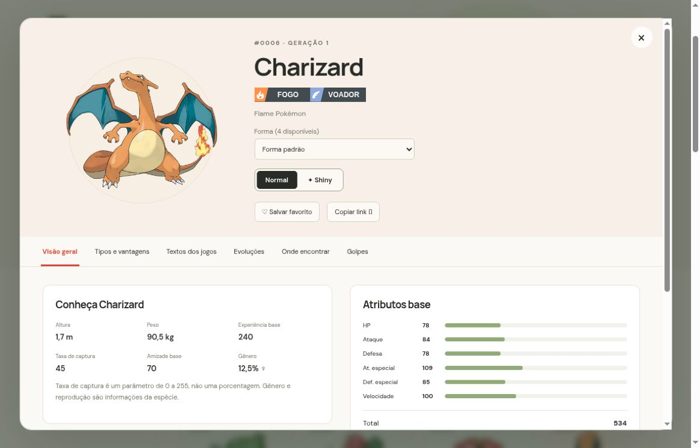

# Pokédex · Um mundo para descobrir

**Uma enciclopédia navegável com as 1.025 espécies da Pokédex Nacional e 1.579 formas registradas**, criada a partir do meu primeiro projeto Java de orientação a objetos.

A aplicação permite pesquisar Pokémon, consultar formas alternativas, entender tipos e fraquezas, acompanhar famílias evolutivas e explorar descrições, golpes e encontros por jogo. O exercício Java original está preservado em [`src/`](src/README.md) e no histórico do repositório.

[Abrir versão hospedada](https://pokedex-luigi-explorer.luigiscofano.chatgpt.site) · [Código no GitHub](https://github.com/luigiscofano/Pokedex)

A instalação hospedada tem acesso controlado pela plataforma; o código público pode ser executado localmente seguindo as instruções abaixo.

[Começar](#executar-em-3-passos) · [Funcionalidades](#o-que-esta-versão-faz) · [Dados](#cobertura-real-dos-dados) · [Arquitetura](#como-o-projeto-está-organizado) · [Testes](#validação) · [Guias](#documentação)


## Qual problema resolve

Informações sobre uma espécie costumam ficar separadas entre jogos, formas, tipos e tabelas. A Pokédex reúne essas consultas em uma única interface, preservando a versão e o idioma dos registros. O objetivo é permitir uma exploração divertida e, ao mesmo tempo, deixar claro de onde cada informação veio e quais são seus limites.

## O que esta versão faz

| Recurso | Como funciona |
| --- | --- |
| Catálogo nacional | 1.025 espécies, de Bulbasaur a Pecharunt, em ordem nacional |
| Formas alternativas | 1.579 entradas de formas da fonte, incluindo regionais, Mega, Gigantamax, variações de aparência e formas de batalha |
| Pesquisa | Nome, número com ou sem `#` e zeros à esquerda, nome da forma e busca sem acentos |
| Filtros | Geração da espécie, tipo, lendários, míticos e inclusão de formas |
| Ordenação | Número nacional, nome e soma dos atributos base |
| Ficha geral | Tipos, altura, peso, habilidades normais/ocultas, atributos base, EVs, criação e taxa de captura |
| Fraquezas e resistências | Composição matemática dos dois tipos; mostra 4×, 2×, 1×, ½×, ¼× e imunidades |
| Vantagens ofensivas | Melhor eficácia de um dos tipos próprios contra alvos de tipo único |
| Textos dos jogos | Descrições originais selecionáveis por jogo e idioma |
| Evoluções | Família completa, incluindo ramificações e condições registradas por grupo de versões |
| Onde encontrar | Versão, área, método, níveis, chance do slot e condições; filtro por jogo |
| Golpes | Aprendizado por grupo de versões, método, nível, maestria quando disponível e busca por nome |
| Favoritos | Guardados neste navegador, por forma selecionada, sem conta ou backend |
| Links de ficha | Parâmetro de URL identifica a forma; botão para copiar o link |
| Navegação acessível | Foco visível, diálogo nativo, abas com teclado, Escape e atalho `/` para pesquisar |
| Celular e computador | Layout responsivo com tabelas e abas roláveis dentro de suas áreas |



## Executar em 3 passos

**Requisito:** [Node.js](https://nodejs.org/) 20 ou superior. Não há dependências npm a instalar.

```sh
git clone https://github.com/luigiscofano/Pokedex.git
cd Pokedex
npm run dev
```

Abra **http://localhost:3000** no navegador. A base de dados já acompanha o projeto; não é necessário executar o importador para usar a aplicação.

Para gerar os arquivos de hospedagem:

```sh
npm run build
```

A saída está em `dist/`. Qualquer hospedagem de arquivos estáticos com suporte a JavaScript ES Modules pode servi-la. **Não abra `index.html` por `file://`**: o navegador precisa de um servidor HTTP para carregar os módulos e os JSONs.

### Exemplos para experimentar

1. Busque `#0025` para abrir Pikachu.
2. Ative **Incluir formas** e busque `charizard`; compare as fichas da forma padrão, Mega X, Mega Y e Gigantamax.
3. Na forma padrão de Charizard, confira Pedra em **4×**, Terra em **0×** e Planta em **¼×**.
4. Abra Eevee e explore seus oito ramos evolutivos.
5. Consulte **Textos dos jogos** e altere idioma e versão.
6. Abra **Onde encontrar**, filtre um jogo e leia as condições de cada slot.
7. Salve um favorito, recarregue a página e abra a lista de favoritos.

## Cobertura real dos dados

| Medida | Snapshot desta versão |
| --- | ---: |
| Espécies nacionais | 1.025 |
| Variedades com atributos próprios | 1.351 |
| Formas catalogadas | 1.579 |
| Textos de Pokédex, somando jogos e idiomas | 68.220 |
| Registros de encontros | 117.127 |
| Registros de aprendizado de golpes | 638.321 |

A revisão exata da PokéAPI, os hashes SHA-256 e as contagens estão em [`web/data/manifest.json`](web/data/manifest.json). O aplicativo usa esses arquivos versionados; não realiza uma consulta à API para cada espécie ao abrir o catálogo.

### Limites importantes

- **Idioma:** a interface é em português. Textos oficiais, nomes de golpes e descrições de habilidades preservam os idiomas disponíveis na fonte. Não são apresentadas traduções inventadas como texto oficial.
- **Locais:** falta de encontros significa falta de registros na base, não impossibilidade de obtenção no jogo. Trocas, presentes, eventos e jogos recentes podem ter cobertura incompleta.
- **Regras de batalha:** fraquezas usam a tabela moderna de tipos. Habilidades, itens, clima, Terastalização e mudanças históricas de tipos não são simulados.
- **Golpes:** o repertório é separado por versão; poder, precisão e efeitos usam a definição atual da fonte, sem reconstrução histórica completa.
- **Evoluções:** o grupo de versões indicado é o registro da fonte, não uma lista exaustiva de todos os jogos compatíveis. Requisitos especiais não traduzidos continuam identificados como campos da fonte.
- **Imagens:** ilustrações e sprites são externos. Formas cosméticas usam seu sprite específico quando disponível; a ausência é identificada e a aplicação continua funcionando.
- **Atualizações:** a cobertura corresponde à revisão registrada. Novos conteúdos da franquia precisam de atualização do snapshot.
- **Favoritos:** não sincronizam entre dispositivos. Navegação privada, limpeza do navegador ou bloqueio de armazenamento podem impedir a persistência.

Detalhes em [fontes e créditos](docs/FONTES.md) e no [guia de dados](docs/dados/README.md).

## Como o projeto está organizado

| Caminho | Responsabilidade |
| --- | --- |
| [`web/`](web/README.md) | Aplicação web que roda no navegador |
| [`web/js/`](web/js/README.md) | Interface, regras de domínio e acesso aos dados |
| [`web/data/`](web/data/README.md) | Catálogo, referências e manifesto de proveniência |
| [`web/data/species/`](web/data/species/README.md) | Fichas agrupadas em lotes de até 50 espécies |
| [`scripts/`](scripts/README.md) | Servidor, build, verificação e importação |
| [`tests/`](tests/README.md) | Testes automatizados e roteiro de conferência visual |
| [`docs/`](docs/README.md) | Guias de uso, arquitetura, dados e publicação |
| [`docs/imagens/`](docs/imagens/README.md) | Capturas reais da aplicação |
| [`src/`](src/README.md) | Exercício Java original, independente da aplicação web |
| [`.github/`](.github/README.md) | CI e modelo de pull request |

### Decisões técnicas

A aplicação usa **HTML, CSS e JavaScript com ES Modules**, sem framework ou dependências de execução. O importador usa apenas a biblioteca padrão do **Python**. O servidor e os testes usam recursos nativos do **Node.js**.

O catálogo carrega primeiro; os detalhes são carregados por lote quando uma ficha é aberta. As promessas são reutilizadas durante a sessão, e erros permitem uma nova tentativa. O catálogo renderiza 24 cartões por vez. A distinção entre **espécie**, **variedade** e **forma** evita tratar IDs diferentes como se fossem o mesmo conceito.

## Validação

```sh
npm run check
npm test
npm run build
```

São **14 testes automatizados** cobrindo cálculos de tipos, busca, filtros, favoritos, fronteiras de lotes, condições de evolução, contagem de espécies, todas as referências da base e hashes dos arquivos. O workflow de CI executa essas verificações e, em um job separado, compila e executa o Java original.

A interface também foi conferida no navegador em desktop e em uma área de visualização de celular, incluindo pesquisa, formas, descrições, evoluções, encontros e golpes. Consulte o [roteiro de testes](tests/README.md).

## Executar o Java original

O programa de 2023 continua sendo uma demonstração independente no terminal, com quatro Pokémon e operações de cópia/dano. **Ele não é o backend da aplicação web.**

Requisito: JDK 17+ com `javac` e `java` no PATH.

```sh
javac -encoding UTF-8 -d build/classes -sourcepath src src/Main.java
java -cp build/classes Main
```

Seu comportamento original foi mantido, inclusive os limites documentados em [`src/README.md`](src/README.md): não há persistência, validação completa de vida ou catálogo nacional nesse módulo.

## O que desenvolvi e aprendi

O projeto evoluiu de modelagem básica em Java para uma aplicação orientada a dados. Os principais aprendizados envolvidos são separação de responsabilidades, modelagem de entidades relacionadas, normalização e auditoria de dados, importação reproduzível, carregamento sob demanda, estados assíncronos, navegação acessível, regras de domínio verificáveis e documentação para quem chega ao repositório pela primeira vez.

## Estado atual

A enciclopédia web descrita acima está implementada. O Java original continua disponível e preservado. Recursos que dependem de dados ausentes não são apresentados como concluídos: o projeto não promete catálogo de eventos completo, reconstrução de toda regra histórica, simulador de batalha ou sincronização em nuvem.

## Documentação

- [Mapa da documentação](docs/README.md)
- [Guia de uso](docs/usuario/README.md)
- [Arquitetura e desenvolvimento](docs/desenvolvimento/README.md)
- [Dados, IDs e atualização](docs/dados/README.md)
- [Build e publicação](docs/publicacao/README.md)
- [Fontes, créditos e cobertura](docs/FONTES.md)
- [Como contribuir](CONTRIBUTING.md)
- [Histórico de mudanças](CHANGELOG.md)

## Autoria e créditos

Projeto de **Luigi Scofano de Araujo**. Dados e imagens da comunidade **PokéAPI**, com créditos e limites descritos em [`docs/FONTES.md`](docs/FONTES.md). Pokémon, nomes, personagens, ilustrações e textos pertencem aos respectivos titulares. Este projeto é independente e não possui afiliação oficial.

Nenhuma nova licença geral foi adicionada. A visibilidade pública do repositório não transfere a autoria e não concede, por si só, licença de redistribuição de todos os seus conteúdos.
