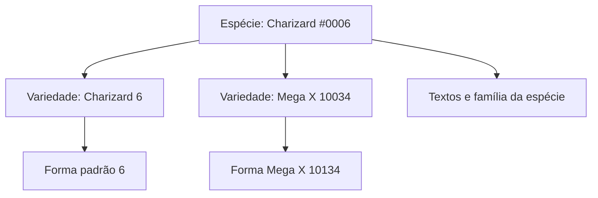

# Dados, cobertura e atualização

[Início](../../README.md) · [Documentação](../README.md) · [Esquema dos arquivos](../../web/data/README.md)

A aplicação utiliza uma **cópia versionada** dos CSVs da PokéAPI. Essa cópia acompanha o clone e é servida como arquivos JSON. Instalar ou executar a Pokédex não exige importar dados novamente.

## Cobertura auditável

| Medida | Quantidade |
| --- | ---: |
| Espécies nacionais | 1.025 |
| Variedades | 1.351 |
| Formas, incluindo as padrão | 1.579 |
| Textos por jogo e idioma | 68.220 |
| Registros de encontros | 117.127 |
| Registros de aprendizado de golpes | 638.321 |
| Lotes de fichas | 21, com até 50 espécies por lote |

Revisão: [`e5b79b2e15d7c50735a945936afd4cd1cfd94eae`](https://github.com/PokeAPI/pokeapi/tree/e5b79b2e15d7c50735a945936afd4cd1cfd94eae). O [manifesto](../../web/data/manifest.json) é a referência das contagens e dos hashes; a data de uma captura de tela não é a revisão da base.

## Três identidades, três responsabilidades

| Entidade | Exemplo concreto | Dados associados |
| --- | --- | --- |
| Espécie | Charizard, `species=6` | Nome, geração, descrições, família e reprodução |
| Variedade | Mega Charizard X, `pokemon=10034` | Tipos, atributos, habilidade, dimensões, golpes e encontros |
| Forma | Mega Charizard X, `id=10134` | Entrada selecionável, nome da forma e vínculo com a variedade |

Unown B usa uma forma distinta que compartilha a variedade de Unown. Já Mega Charizard X tem outra variedade, pois seus tipos e atributos mudam. Usar indiscriminadamente o mesmo ID para essas entidades produz fichas ou imagens erradas.



## Fluxo da importação

O script [import-data.py](../../scripts/import-data.py) baixa tabelas CSV do SHA escolhido, guarda-as em `.cache/<revisão>/`, relaciona seus IDs e grava JSONs UTF-8 compactos. A conversão de altura e peso entrega metros e quilogramas. Espaços e quebras dos textos são normalizados, preservando idioma e conteúdo dos registros.

Downloads e gravações usam arquivo temporário seguido de substituição por arquivo. A publicação de **todos** os arquivos não é uma transação única: só aceite o conjunto depois de concluir a geração e a verificação. Não interrompa uma importação e publique seus resultados parciais.

### Reproduzir a revisão atual

```sh
python3 scripts/import-data.py
npm run check
npm test
```

No Windows, use `py -3 scripts/import-data.py` se o comando `python3` não estiver disponível. A primeira execução precisa de rede; execuções seguintes podem reutilizar os CSVs daquela revisão. Não versionar `.cache/`.

### Atualizar para outra revisão

1. Escolha e revise um commit da fonte; não use uma referência móvel como substituto do registro de proveniência.
2. Crie uma branch específica para dados.
3. Defina `POKEAPI_REVISION` com o SHA escolhido ou altere o padrão no script.
4. Execute a importação e todas as verificações.
5. Revise as contagens, os exemplos de formas, as referências e o tamanho do diff.
6. Para adotar a revisão, registre também o novo padrão do importador e explique a mudança no PR.

O script limita intencionalmente o catálogo às espécies **1–1025**. Ampliar esse escopo exige revisar filtros, loteamento, testes e documentação, além de atualizar os dados.

## Como aceitar os resultados

O teste de dados compara os arquivos com os hashes do manifesto, resolve referências e confere contagens. Um hash confirma consistência de bytes; não demonstra sozinho que uma interpretação do jogo esteja correta. Por isso, revise exemplos conhecidos e os campos alterados pela fonte.

Não corrija apenas um JSON gerado: a próxima importação apagaria a alteração. Modifique a transformação ou a origem revisada e reconstrua a base de maneira rastreável.

## Limites de interpretação

- Um texto pertence à espécie e pode não distinguir cada forma.
- Encontros não cobrem necessariamente eventos, presentes, trocas e todos os jogos recentes.
- Um slot não é uma probabilidade agregada de captura.
- Aprendizado por jogo e definição atual de poder/precisão são dimensões diferentes.
- Imagens são externas e podem mudar independentemente do snapshot de atributos.
- Ausências e campos sem tradução devem continuar explícitos.

[Fontes e créditos](../FONTES.md) · [Dicionário dos JSONs](../../web/data/README.md) · [Lotes](../../web/data/species/README.md).
