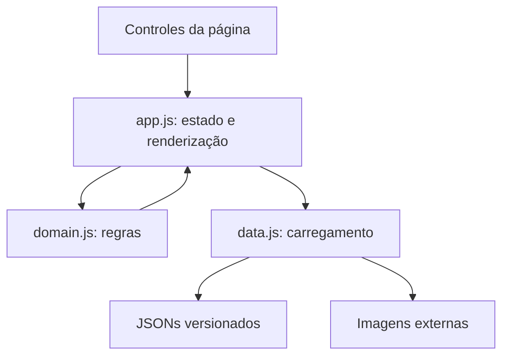

# Arquitetura e desenvolvimento

[Início](../../README.md) · [Documentação](../README.md) · [Código web](../../web/README.md)

A aplicação é estática: HTML, CSS e módulos JavaScript executam no navegador. O Node entrega arquivos no desenvolvimento e executa build/verificações. O Python só participa da importação da base. O Java original é um exercício separado.

## Mapa de responsabilidades

| Parte | Arquivos | Responsabilidade |
| --- | --- | --- |
| Estrutura e estilo | `web/index.html`, `web/styles.css` | Conteúdo inicial, controles, diálogos, responsividade e identidade visual |
| Coordenação da interface | `web/js/app.js` | Estado, eventos, renderização, URL e seleção de fichas/abas |
| Domínio | `web/js/domain.js` | Filtros, ordenação, tipos, favoritos, lotes e condições de evolução |
| Dados | `web/js/data.js` | Fetch, cache de promessas, recuperação e seleção de imagens |
| Snapshot | `web/data/` | Catálogo, referências, fichas e manifesto |
| Ferramentas | `scripts/` | Servir, gerar saída, verificar e importar |
| Validação | `tests/` | Regras e consistência da base, sem dependências externas |

## Da abertura da página à ficha

1. `init()` carrega catálogo, referências e manifesto em paralelo.
2. Os parâmetros da URL são lidos e os controles são preenchidos.
3. `filterCatalog()` seleciona e ordena registros; a interface renderiza os primeiros 24.
4. `openDetail()` resolve o ID da forma no catálogo.
5. `loadSpecies()` calcula o lote da espécie e reutiliza a promessa de carga.
6. `currentPokemon()` encontra a variedade pelo campo `pokemon` da forma.
7. A aba escolhida transforma os dados em elementos de interface.

A ficha não consulta uma API remota de atributos a cada clique: ela lê o JSON servido junto da aplicação. A aba Evoluções pode carregar lotes adicionais para reunir a família.

## Estado e concorrência

`state` concentra pesquisa, filtros, limite de cartões, favoritos, modo shiny, forma, espécie, aba e seletores internos. `syncURL()` serializa apenas busca, geração, tipo, inclusão de formas, shiny e ficha. Veja [o contrato dos links](../usuario/favoritos-e-links/README.md).

| Risco | Tratamento implementado |
| --- | --- |
| Abrir A e depois B antes de A carregar | `detailRequest` impede que a resposta de A substitua B |
| Trocar de aba durante uma carga de evoluções | `tabRequest` invalida o resultado antigo |
| Trocar Normal/Shiny com sprite ainda pendente | A resposta só atualiza a imagem original se ela ainda estiver conectada ao documento |
| Falha de fetch guardada no cache | A promessa rejeitada é removida para permitir nova tentativa |
| Navegador bloqueia favoritos | A interface mantém estado da sessão e avisa que não houve persistência |

O cache vive na memória da página. Recarregar inicia uma nova sessão de requisições; favoritos usam armazenamento persistente separado. Há estado de carregamento, erro e nova tentativa nas fichas e painéis.

## Regras de dados que devem ser preservadas

- `species` é o número nacional; `pokemon` é a variedade; `id` no catálogo é a forma.
- Não misture repertórios de golpes de grupos de jogos diferentes.
- Não transforme ausência de encontros em impossibilidade de obtenção.
- Não substitua uma imagem shiny ausente por uma normal sem identificação.
- Tipos especiais sem matriz moderna recebem um aviso, não eficácia neutra inventada.
- A geração do filtro pertence à espécie. `introduced` é um grupo de versões da forma.

## Interface e acessibilidade

O diálogo usa `dialog`. Abas expõem seleção e associação ao painel; setas, Home e End permitem navegação. Há foco visível, rótulos e preferência de movimento reduzido no CSS. Tabelas e abas rolam dentro de suas áreas em telas estreitas. Esses recursos foram conferidos em Chromium; não constituem uma auditoria completa de acessibilidade em todos os leitores e dispositivos.

Textos usados em HTML passam por `escapeHTML()`. A carga de sprites de formas aceita URLs HTTPS de `raw.githubusercontent.com`. A aplicação não possui login próprio nem requer segredos no frontend. A hospedagem pode acrescentar seu próprio controle de acesso.

## Como localizar uma alteração

| Quero mudar… | Comece por… | Confira depois |
| --- | --- | --- |
| Textos fixos, título ou rodapé | `web/index.html` | Navegador e links da página |
| Layout e badges de tipos | `web/styles.css` | Desktop, celular, foco e contraste |
| Busca ou multiplicadores | `web/js/domain.js` | Testes de domínio e exemplos de referência |
| Uma aba da ficha | `web/js/app.js` | Forma padrão/alternativa e ausência de dados |
| Cache ou imagens shiny | `web/js/data.js` | Testes de imagens e alternância rápida |
| Campos da base | `scripts/import-data.py` | Snapshot, manifesto, referências e contagens |

Antes de editar, crie uma branch a partir de `main`. Leia [CONTRIBUTING.md](../../CONTRIBUTING.md), execute as verificações adequadas e descreva o comportamento final no PR.

## Decisões e compromissos

Módulos nativos e ferramentas pequenas reduzem a preparação do ambiente. JSONs versionados tornam a origem dos dados auditável, mas aumentam o tamanho do repositório. Lotes por espécie limitam cargas repetidas, embora cada lote traga também informações de outras espécies. Renderização por trechos evita construir todo o catálogo de uma vez.

Não há framework, banco de dados, service worker, instalação PWA, sincronização em nuvem ou simulador de batalhas nesta implementação. Possíveis extensões precisam de projeto e validação próprios.

[Regras de tipos em detalhe](tipos/README.md) · [Dados e importação](../dados/README.md) · [Publicação](../publicacao/README.md).
