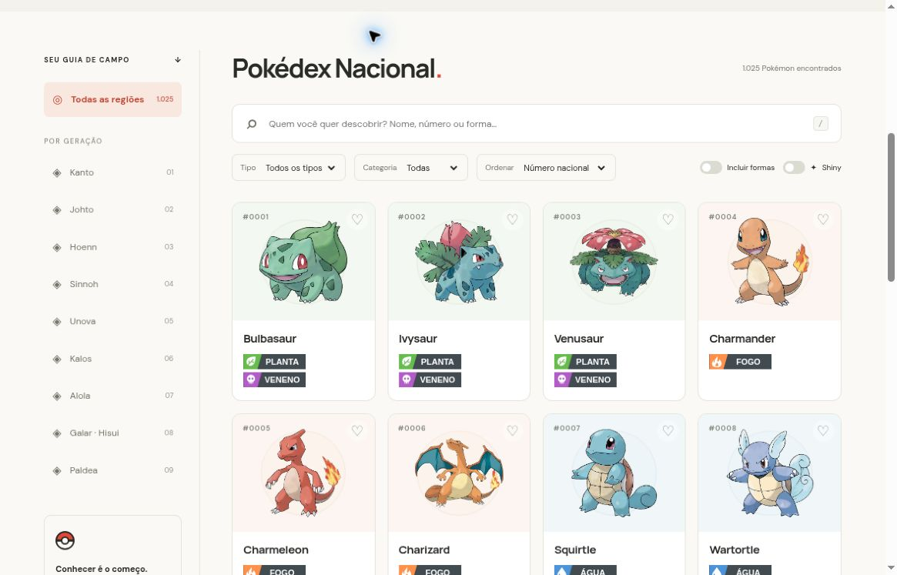

# Organização do código e comentários em português

[Início](../../../README.md) · [Arquitetura](../README.md) · [Módulos JavaScript](../../../web/js/README.md) · [Contribuir](../../../CONTRIBUTING.md)

A refatoração 1.1.2 torna explícitas as responsabilidades que antes estavam concentradas em funções longas ou trechos compactos. O objetivo é facilitar leitura, manutenção e revisão, preservando a experiência da Pokédex.

## Princípios aplicados

| Princípio | Aplicação concreta |
| --- | --- |
| Responsabilidade definida | Painéis geram HTML; o controlador coordena eventos, estado e cargas |
| Nomes descritivos | Forma, variedade, espécie, IDs e condições têm nomes que indicam seu papel |
| Funções menores | Filtros, ordenação, linhas de tabelas, instalação de eventos e etapas do importador foram separados |
| Redução de repetição | Cache de promessas, escape HTML, componentes comuns e validação de tipos são reutilizados |
| Contratos explícitos | Erros, dados ausentes, IDs, seleção de jogos e comportamento histórico do Java estão documentados |
| Constantes | Paginação, duração de avisos, revisão da fonte e parâmetros de importação ficam identificados |
| Formatação consistente | Blocos, indentação e quebras de linha seguem convenções versionadas |
| Verificação de comportamento | Testes permanentes e comparações com a versão anterior acompanham a mudança estrutural |

## Como encontrar uma responsabilidade

| Preciso alterar… | Arquivo principal |
| --- | --- |
| Busca, ordenação ou cálculo de tipos | [domain.js](../../../web/js/domain.js) |
| Cache, JSON ou endereço de sprite | [data.js](../../../web/js/data.js) |
| Escape e pequenos componentes visuais | [presentation.js](../../../web/js/presentation.js) |
| Seleção de idioma/jogo ao abrir um painel | [detail-selection.js](../../../web/js/detail-selection.js) |
| Conteúdo das seis abas | [detail-panels.js](../../../web/js/detail-panels.js) |
| Imagem cosmética, legenda ou fallback | [images.js](../../../web/js/images.js) |
| Eventos, URL e sequência assíncrona | [app.js](../../../web/js/app.js) |
| Transformação dos CSVs | [import-data.py](../../../scripts/import-data.py) |
| Exercício Java | [Guia de src](../../../src/README.md) |

## Comentários úteis

Os comentários estão em português e explicam **por que uma decisão existe**, como uma seção se encaixa no fluxo ou qual contrato precisa ser mantido. Exemplos presentes no código:

- Uma resposta antiga não pode substituir a ficha que a pessoa acabou de selecionar.
- Uma promessa rejeitada precisa sair do cache para permitir nova tentativa.
- O número nacional não substitui IDs de forma ou variedade.
- Zero pode representar uma condição de evolução válida.
- A ausência de imagem shiny não permite usar a normal como substituta silenciosa.
- O construtor de cópia Java restaura a vida total por compatibilidade com o exercício.

Evite comentários que apenas repitam uma atribuição, índices de seção que ficam desatualizados e código antigo comentado. O histórico Git preserva versões anteriores. Ao mudar um contrato, atualize o comentário e o teste correspondente.

## Formatação e edição

[.editorconfig](../../../.editorconfig) define UTF-8, LF e indentação. [.prettierrc.json](../../../.prettierrc.json) configura JavaScript, HTML/CSS e SVG; [.prettierignore](../../../.prettierignore) exclui dados gerados, caches e builds.

Para conferir a formatação opcional, na raiz:

```sh
npx --yes prettier@3.6.2 --check "web/**/*.{js,html,css,svg}" "scripts/*.mjs" "tests/*.mjs" .prettierrc.json
```

Esse comando pode baixar a ferramenta na primeira execução; ela não é uma dependência de execução da Pokédex. Troque `--check` por `--write` apenas nos arquivos que pretende formatar. Não reformate JSONs gerados: seus bytes são auditados pelo manifesto.

O importador foi formatado com Black 25.9.0. Java mantém indentação de quatro espaços, documentação de contratos e nomes legíveis. Não é necessário instalar esses formatadores para abrir o site ou executar os testes Node.

## Como a preservação foi conferida

- 29 testes permanentes: domínio, integridade da base, imagens, carregamento e painéis/seleção.
- 504 combinações de filtros comparadas com a implementação anterior.
- 11.058 comparações de HTML/imagens, incluindo as 1.579 formas e famílias selecionadas.
- 24 JSONs reconstruídos a partir dos CSVs da mesma revisão, todos idênticos em bytes.
- Conferência no navegador de catálogo, formas, shiny, fichas, textos, golpes, favoritos, links, teclado e família de Eevee.
- Compilação e execução do exercício Java pelo CI com JDK 17.

As comparações com a versão anterior foram verificações pontuais desta refatoração; não são etapas permanentes do CI. Os testes não substituem uma auditoria completa de acessibilidade nem a disponibilidade dos recursos externos. Veja o [registro de validação](../../VALIDACAO.md).



*Captura real do preview local da versão 1.1.2, após a conferência do fluxo de navegação.*

## Limites preservados

Esta entrega não altera o snapshot, cria mecânicas de batalha, acrescenta sincronização de favoritos ou modifica os contratos públicos do Java. O método `porcentagemVida()` continua retornando uma razão, e as operações de vida mantêm os limites históricos descritos no [modelo](../../../src/model/README.md). Mudanças funcionais futuras devem ter escopo e testes próprios.
