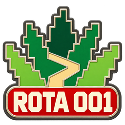

# Insígnia Rota 001

**Rota 001** é a Pokédex de fã de Luigi Scofano de Araujo. A insígnia representa o momento de entrar na grama alta da primeira rota e encontrar uma nova espécie. A placa lembra a sinalização do mapa e o número 001 remete a Bulbasaur, a primeira entrada da Pokédex Nacional.

## Arquivos da marca

| Arquivo | Dimensões | Aplicação |
| --- | --- | --- |
| [PNG original](rota-001.png) | 1254 × 1254 px | Arte aprovada em resolução integral, com fundo transparente |
| [PNG para interfaces](../../web/marca/rota-001-256.png) | 256 × 256 px | Cabeçalho, rodapé, documentação e portfólio |
| [Ícone do navegador](../../web/marca/rota-001-64.png) | 64 × 64 px | Aba do navegador |

Todas as versões mantêm a insígnia inteira, incluindo a placa com o nome. Ao redimensionar, preserve a proporção e a transparência.

[Voltar à apresentação da Pokédex](../../README.md)
