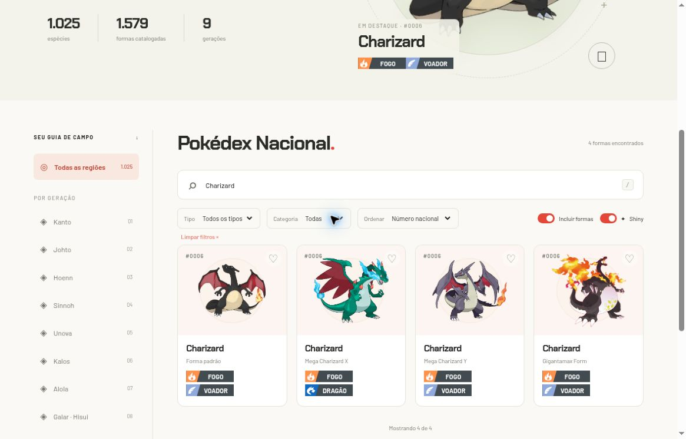
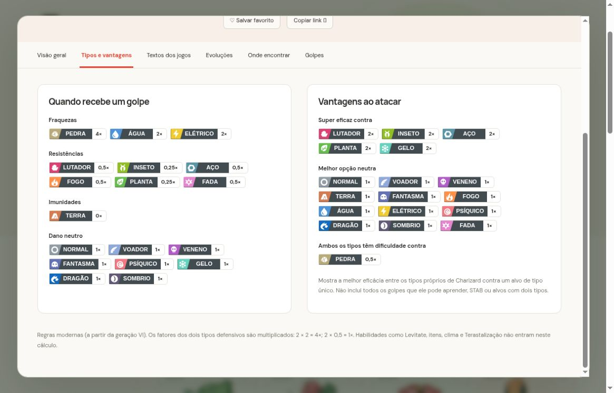
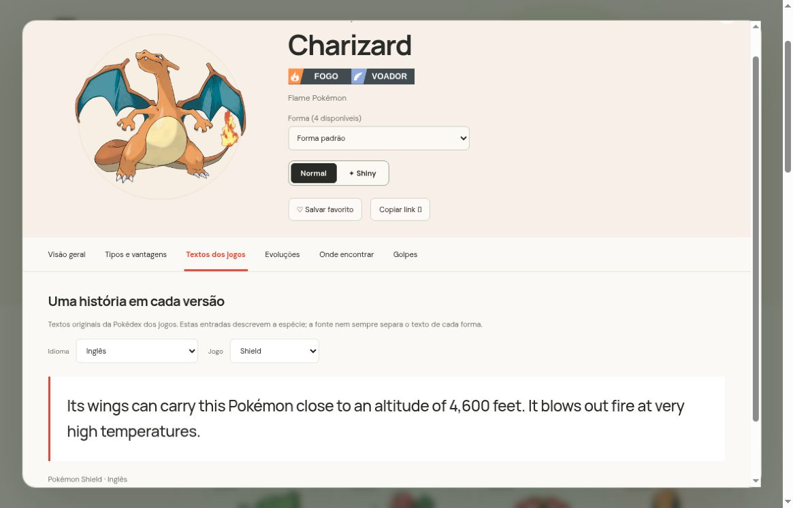
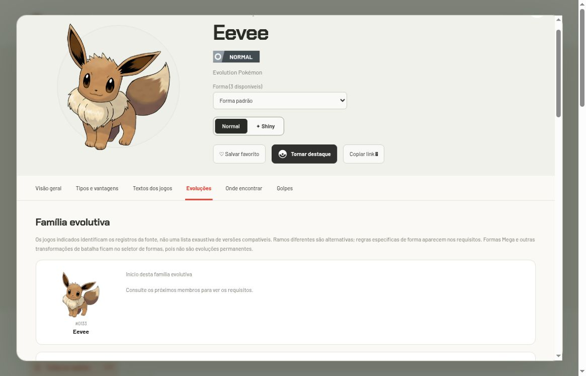
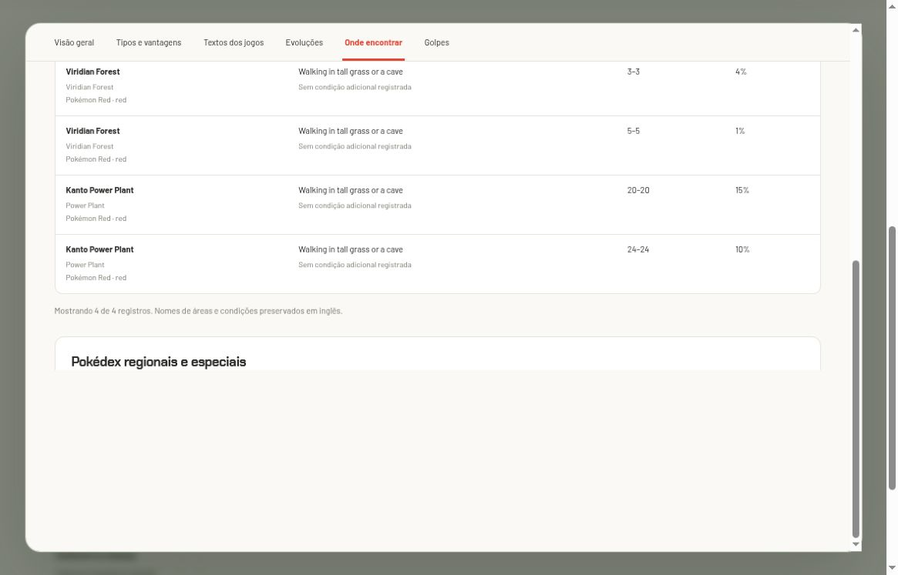
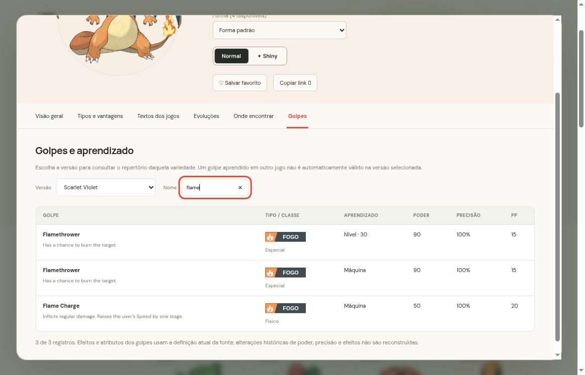

# Galeria de capturas reais

[Início](../../README.md) · [Guia de uso](../usuario/README.md) · [Validação](../VALIDACAO.md)

Estas imagens foram capturadas no navegador em **2 de novembro de 2026**. Mostram o produto implementado, sem mockups ou reconstruções geradas. A captura da refatoração documenta a versão 1.1.2 no preview local. As demais registram as versões anteriores, identificadas abaixo.

| Arquivo | Versão | Conteúdo e contexto |
| --- | --- | --- |
| [pokedex-refatoracao.jpg](pokedex-refatoracao.jpg) | 1.1.2 | Página inicial após a refatoração, conferida no preview local; aparência preservada |
| [pokedex-inicio.jpg](pokedex-inicio.jpg) | 1.1.1 | Página inicial com “Temos que pegar!” e catálogo |
| [pokedex-formas.jpg](pokedex-formas.jpg) | 1.1.1 | Busca Charizard, inclusão de formas e modo Shiny; quatro cartões |
| [pokedex-tipos.jpg](pokedex-tipos.jpg) | 1.1.1 | Tipos de Charizard padrão, defesa e melhores eficácias ofensivas |
| [pokedex-textos.jpg](pokedex-textos.jpg) | 1.1.1 | Texto de Charizard em inglês para Shield, com seletores |
| [pokedex-evolucoes.jpg](pokedex-evolucoes.jpg) | 1.1.1 | Trecho da família de Eevee, com Flareon, Espeon e Umbreon; outros ramos ficam acima/abaixo |
| [pokedex-encontros.jpg](pokedex-encontros.jpg) | 1.1.1 | Encontros de Pikachu em Red, incluindo slots de Viridian Forest |
| [pokedex-golpes.jpg](pokedex-golpes.jpg) | 1.1.1 | Golpes de Charizard em Scarlet Violet, filtrados por `flame` |
| [pokedex-shiny.jpg](pokedex-shiny.jpg) | 1.1.0 | Ficha shiny de Charizard e badges com contorno, após introdução desses recursos |
| [pokedex-ficha.jpg](pokedex-ficha.jpg) | 1.0.0 | Registro histórico da ficha anterior aos controles shiny e ao contorno dos tipos |

## Catálogo e formas

A geração do filtro é a da espécie; as quatro entradas não são quatro números nacionais diferentes.

## Fichas por contexto

## Atualizar as imagens

Capture uma interação real, escolha um recorte legível, retire informações pessoais e salve com nome descritivo. Atualize a legenda, a versão e os guias que dependem da imagem. Não apresente uma captura histórica como estado atual de um recurso que mudou.

As imagens de Pokémon visíveis nas capturas pertencem aos respectivos titulares e são disponibilizadas pelas fontes creditadas. Consulte [fontes e créditos](../FONTES.md).
