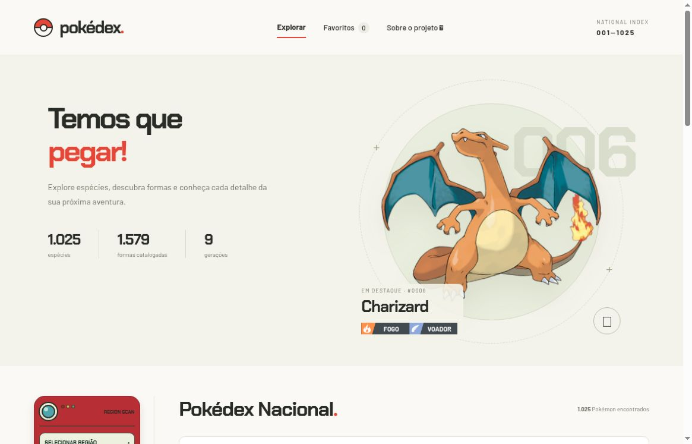
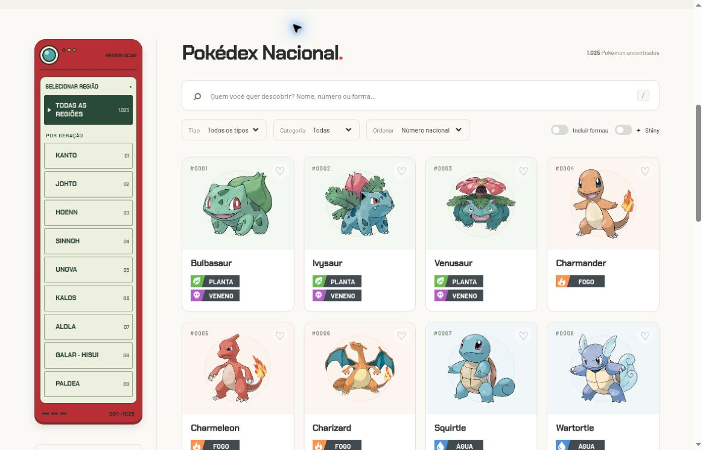
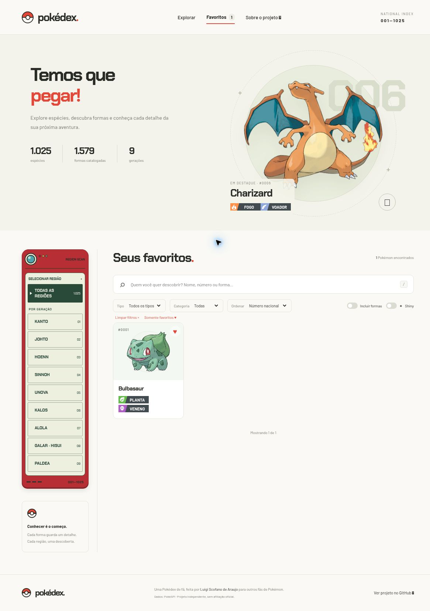
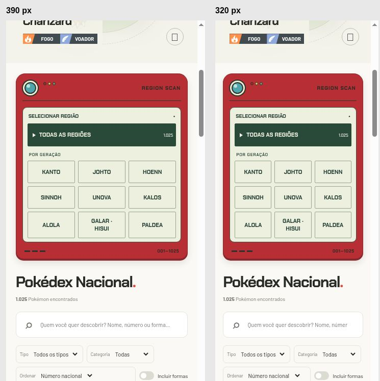

# Galeria de capturas reais

[Início](../../README.md) · [Guia de uso](../usuario/README.md) · [Validação](../VALIDACAO.md)

As capturas atuais são as referências visuais desta revisão. As imagens anteriores permanecem como histórico: podem mostrar tipografia, símbolos, textos ou controles já alterados. Não use uma imagem histórica para concluir como a interface aparece hoje.

## Capturas atuais

Capturas da aplicação real em **09/11/2026**, sem reconstrução por desenho ou geração de imagem. A página inicial, as regiões, os favoritos e a visualização estreita documentam estados diferentes da mesma interface.

| Arquivo | Conteúdo e contexto |
| --- | --- |
| [pokedex-inicio-atual.jpg](pokedex-inicio-atual.jpg) | Início com “Temos que pegar!”, descrição e destaque; sem o antigo CTA ou texto introdutório |
| [pokedex-regioes-atual.jpg](pokedex-regioes-atual.jpg) | Pokédex de bolso, carcaça vermelha discreta, tela LCD e regiões integradas |
| [pokedex-favoritos-atual.jpg](pokedex-favoritos-atual.jpg) | Favoritos selecionado no menu, coleção filtrada e quantidade de resultados em negrito |
| [pokedex-mobile-atual.jpg](pokedex-mobile-atual.jpg) | Frames de 390 e 320 pixels, com regiões em grade; simulação responsiva, não aparelho físico |

O [registro de validação](../VALIDACAO.md) descreve a origem e o alcance da conferência. Uma captura comprova o estado mostrado, não todas as combinações de filtros, dispositivos ou condições de rede.

## Arquivo histórico

Estes arquivos foram preservados das entregas anteriores. As onze capturas gerais estavam documentadas na versão 1.3.2; as capturas de destaque acompanham a evolução 1.3.0–1.3.2. A página inicial dessas etapas ainda tinha controles e textos removidos depois. O [histórico](../../CHANGELOG.md) e a [validação](../VALIDACAO.md) registram esse contexto, sem tratá-lo como a aparência atual.

| Arquivo | Contexto preservado |
| --- | --- |
| [pokedex-refatoracao.jpg](pokedex-refatoracao.jpg) | Início de uma etapa anterior da interface |
| [pokedex-inicio.jpg](pokedex-inicio.jpg) | Início com CTA e texto introdutório posteriormente removidos |
| [pokedex-formas.jpg](pokedex-formas.jpg) | Quatro formas de Charizard com Shiny |
| [pokedex-tipos.jpg](pokedex-tipos.jpg) | Defesa e eficácia de Charizard |
| [pokedex-textos.jpg](pokedex-textos.jpg) | Charizard, texto em inglês para Shield |
| [pokedex-evolucoes.jpg](pokedex-evolucoes.jpg) | Trecho da família evolutiva de Eevee |
| [pokedex-encontros.jpg](pokedex-encontros.jpg) | Pikachu em Red, áreas e chances por slot |
| [pokedex-golpes.jpg](pokedex-golpes.jpg) | Charizard, Scarlet Violet, busca `flame` |
| [pokedex-shiny.jpg](pokedex-shiny.jpg) | Ficha shiny de Charizard |
| [pokedex-ficha.jpg](pokedex-ficha.jpg) | Ficha normal, atributos e botão de destaque da interface anterior |
| [pokedex-mobile.jpg](pokedex-mobile.jpg) | Fichas em frames de 320 e 375 pixels; simulação responsiva |
| [pokedex-destaque.jpg](pokedex-destaque.jpg) | Início com Mega Charizard X shiny como destaque |
| [pokedex-destaque-mobile.jpg](pokedex-destaque-mobile.jpg) | Destaque em frames de 320/375 pixels |
| [pokedex-destaque-catalogo.jpg](pokedex-destaque-catalogo.jpg) | Catálogo sem botão de destaque nos cartões |
| [pokedex-destaque-grafite.jpg](pokedex-destaque-grafite.jpg) | Botão grafite Tornar destaque dentro da ficha |
| [pokedex-destaque-ficha.jpg](pokedex-destaque-ficha.jpg) | Estado Em destaque após a seleção |

Os exemplos de consultas nos guias continuam úteis para explicar formas, textos, encontros, golpes e eficácia. A apresentação visual atual deve ser conferida nas capturas desta revisão ou diretamente na aplicação.

## Atualizar as imagens

Capture uma interação real, escolha um recorte legível, retire informações pessoais e salve com nome descritivo. Registre data, origem, viewport e comportamento observado no [registro de validação](../VALIDACAO.md); atualize a legenda e os guias afetados. Não amplie artificialmente uma captura pequena nem apresente uma imagem histórica como estado atual.

As imagens de Pokémon visíveis nas capturas pertencem aos respectivos titulares e são disponibilizadas pelas fontes creditadas. Consulte [fontes e créditos](../FONTES.md).
