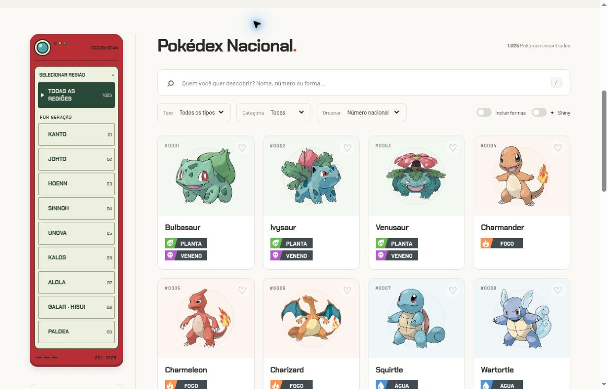
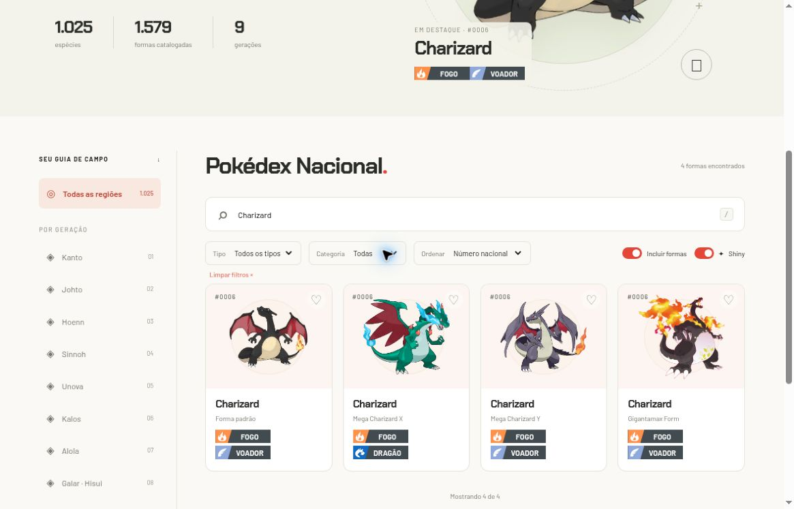

# Catálogo, pesquisa e filtros

[Início](../../../README.md) · [Guia de uso](../README.md)

O catálogo começa com uma forma padrão de cada uma das **1.025 espécies**. São exibidos 24 cartões por vez; **Mostrar mais Pokémon** acrescenta mais 24 resultados. O número no cartão é o número nacional, inclusive quando a forma tem outro identificador interno.

## Escolher a região

O painel lembra uma Pokédex de bolso: carcaça vermelha discreta, tela LCD clara e botões integrados à tela. **Todas as regiões** remove o filtro de geração. Cada região representa a geração de origem da espécie, de Kanto a Paldea; o botão selecionado tem fundo escuro e marcador. Em telas estreitas, as nove opções ficam em uma grade de três colunas.

A contagem de resultados do catálogo aparece em negrito e é atualizada conforme os filtros. O pequeno número ao lado de uma região no desktop identifica sua geração, não quantos resultados a busca encontrou.

## Pesquisar sem decorar o nome exato

| Digite | Resultado esperado |
| --- | --- |
| `25`, `025` ou `#0025` | Pikachu |
| `flabebe` | Flabébé; a busca ignora acentos |
| `charizard` | Charizard; ative formas para incluir Mega e Gigantamax |
| `mega` com **Incluir formas** | Entradas cujo nome, forma ou identificador contém esse texto |
| `unown` com **Incluir formas** | Letras e símbolos de Unown |

A pesquisa compara nome, nome da forma e identificador textual. Ela não interpreta perguntas como “Pokémon que aprende Surf” e não busca por conteúdo das descrições. Use as abas da ficha para essas consultas.

## Combinar filtros

| Controle | Efeito |
| --- | --- |
| Região na Pokédex de bolso | Geração de origem da espécie |
| Tipo | Tipagem da forma selecionável |
| Categoria | Lendários ou míticos |
| Ordenar | Número nacional, nome A–Z ou maior soma de atributos base |
| Incluir formas | Expande o catálogo para 1.579 entradas |
| Shiny | Muda a aparência, sem filtrar nem duplicar espécies |
| Favoritos no menu | Restringe aos IDs de formas salvos neste navegador |

**A geração é da espécie**, não da estreia de cada transformação. Mega Charizard X continua relacionado a Kanto, pois Charizard é da primeira geração. O seletor não é uma lista de todos os jogos em que ele pode ser obtido.

Filtros são combinados. Se você salvou apenas uma forma alternativa e não a encontra nos favoritos, ative **Incluir formas**; filtros de geração, tipo e texto também continuam valendo.

## Exemplo: comparar as formas de Charizard

1. Pesquise `charizard`.
2. Ative **Incluir formas**: aparecem padrão, Mega X, Mega Y e Gigantamax.
3. Ative **Shiny**, se quiser comparar as cores alternativas.
4. Abra uma ficha e use o seletor de forma para comparar dados.

*Captura histórica: busca `charizard`, formas incluídas e modo shiny. O layout e alguns símbolos foram atualizados desde essa imagem. Cada cartão continua mostrando o número nacional #0006.*

## Quando não aparece nenhum resultado

Use **Limpar filtros** e tente novamente. Isso limpa pesquisa, geração, tipo, categoria, ordenação, formas e restrição a favoritos; mantém a preferência visual shiny. O botão não apaga os favoritos guardados.

O total de atributos base é uma soma de seis valores. Ele não prevê quem vence uma batalha nem substitui análise de habilidade, golpes, treinamento e contexto.

**Código relacionado:** [filtros e ordenação](../../../web/js/domain.js) · [interface do catálogo](../../../web/js/app.js).
