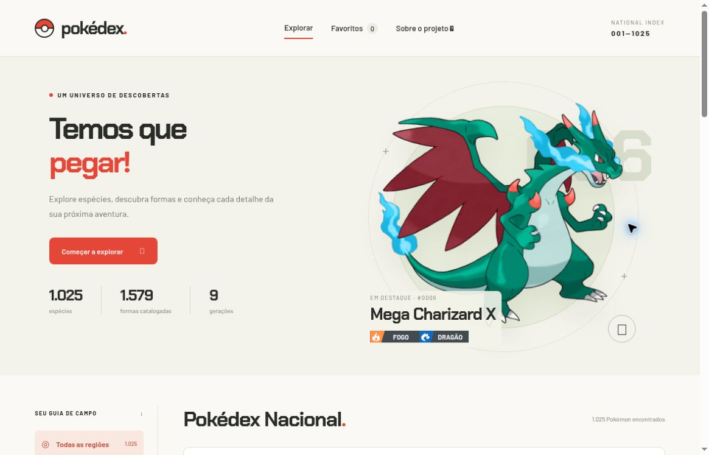

# Destaque, favoritos, links e teclado

[Início](../../../README.md) · [Guia de uso](../README.md)

## Escolher o Pokémon em destaque

Clique no botão grafite com Pokébola **Tornar destaque** nas ações da ficha, depois de abrir um Pokémon. O início passa a mostrar a forma escolhida, seu número nacional e seus tipos. **Em destaque** identifica a seleção atual. O botão de abrir ficha no início acompanha essa escolha.

A preferência fica neste navegador e nesta origem, separada dos favoritos. Ela é mantida ao recarregar a página, mas não sincroniza entre aparelhos e não é incluída nos links. Limpar os dados do site remove a escolha. Sem uma preferência válida, Charizard é o padrão. Se o armazenamento estiver bloqueado, a escolha funciona nesta sessão e um aviso informa que não foi salva.

Formas alternativas também podem ser destaque. A opção **Shiny** continua global: muda a aparência da forma escolhida sem trocar o destaque. A disponibilidade das imagens segue as mesmas regras das fichas.

## Guardar uma forma

Clique no coração de um cartão ou em **Salvar favorito** na ficha. Clique novamente para remover. O menu **Favoritos** mostra a lista filtrada; as demais condições de busca continuam ativas. Para enxergar formas alternativas salvas, ative **Incluir formas**.

O favorito identifica a forma, não a aparência normal/shiny. Charizard padrão e Mega Charizard X podem ser favoritos distintos; Charizard padrão normal e shiny usam o mesmo favorito.

## Onde os favoritos ficam

A lista usa `localStorage`, no navegador e na origem em que você abriu o site. `localhost:3000`, `localhost:3001` e o site publicado são origens diferentes. Perfis de navegador e aparelhos diferentes também possuem listas independentes.

Não há conta, sincronização em nuvem ou exportação de favoritos na interface. Limpar os dados do site pode apagar a lista. Quando o navegador bloqueia o armazenamento, a aplicação avisa e mantém a alteração apenas na sessão.

## Compartilhar uma ficha

Abra a forma desejada e use **Copiar link**. Se a permissão de copiar falhar, copie o endereço da barra do navegador. Quem recebe precisa conseguir acessar a instalação hospedada; um endereço `localhost` aponta para o computador de quem o abre.

| Parâmetro da URL | O que é preservado |
| --- | --- |
| `q` | Texto pesquisado |
| `gen` | Geração da espécie |
| `type` | ID do tipo |
| `forms=1` | Formas adicionais no catálogo |
| `shiny=1` | Aparência shiny |
| `pokemon` | ID da forma cuja ficha será aberta |

Exemplo local: `http://localhost:3000/?forms=1&shiny=1&pokemon=10134` abre Mega Charizard X shiny. O número 10134 é o ID da forma, não seu número nacional.

Categoria, ordenação, favoritos, quantidade de cartões visíveis, aba aberta e filtros internos de jogo/idioma não são serializados na URL. Uma recarga abre a ficha na visão geral.

## Navegação por teclado

| Tecla | Ação |
| --- | --- |
| `/` | Foca a pesquisa, quando você não está digitando nem com um diálogo aberto |
| Tab / Shift+Tab | Percorre os controles |
| Enter ou Espaço | Aciona o botão ou controle focado, conforme o padrão do navegador |
| ← / → sobre uma aba | Troca a aba da ficha |
| Home / End sobre uma aba | Vai à primeira ou última aba |
| Escape | Fecha o diálogo |

No celular, abas, lista de gerações e tabelas podem ter rolagem horizontal dentro de suas próprias áreas. Use também os rótulos de texto; a informação de tipo não depende somente da cor.
