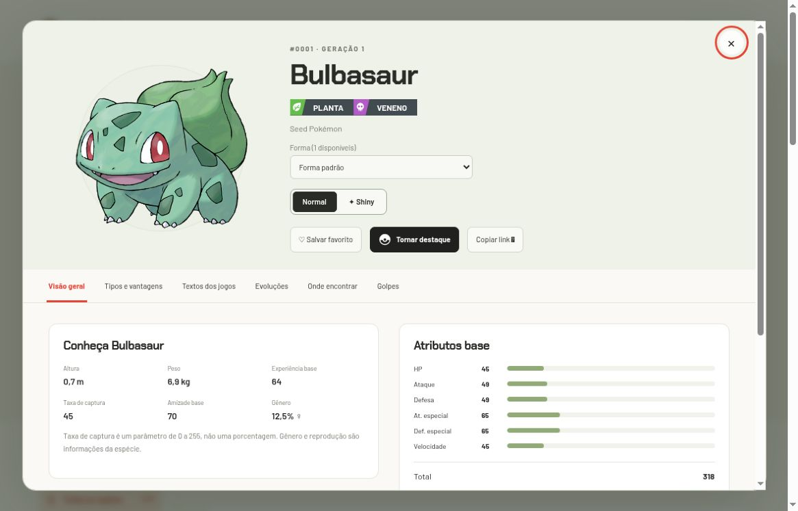
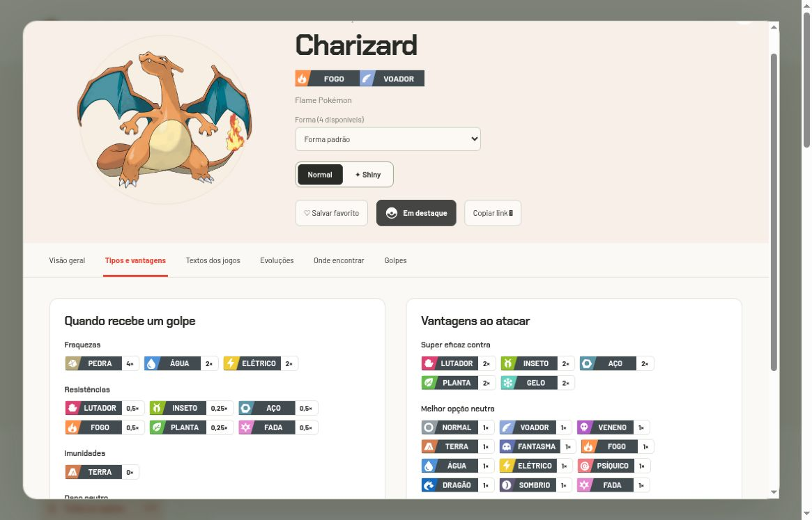
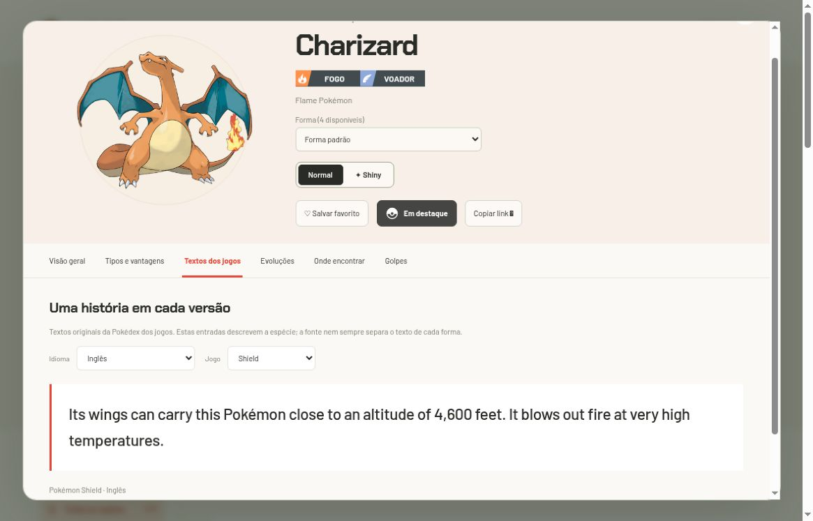
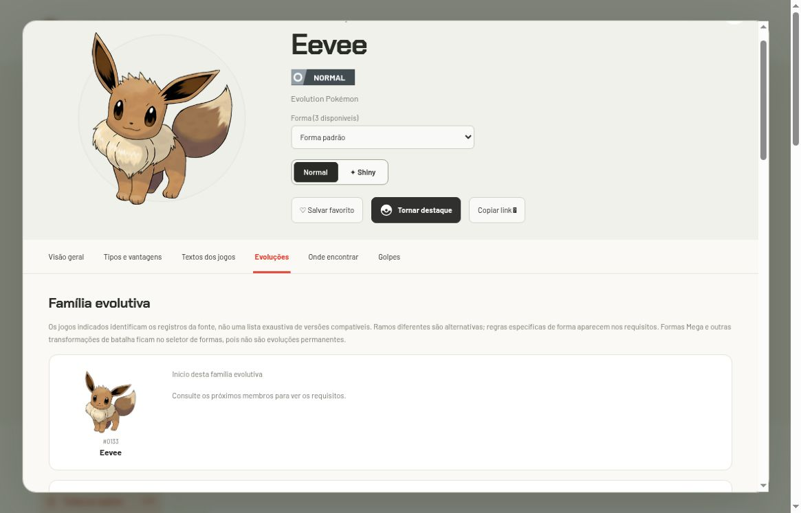
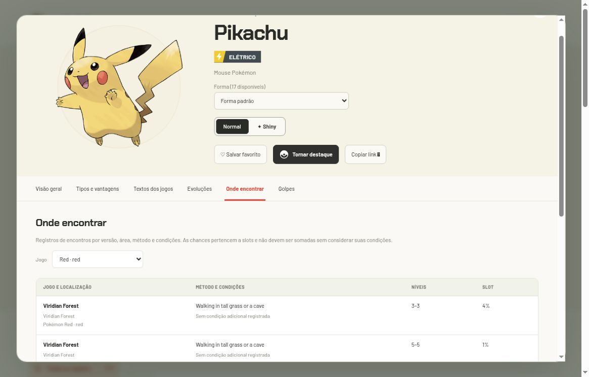
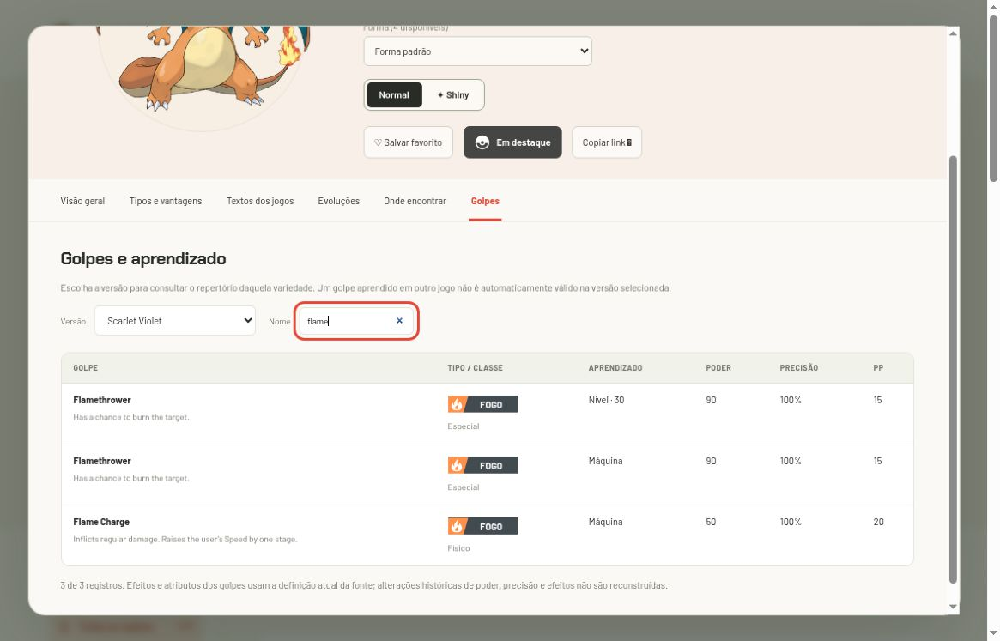

# Como ler as seis abas da ficha

[Início](../../../README.md) · [Guia de uso](../README.md) · [Formas](../formas-e-shiny/README.md)

Clique em um cartão para abrir a ficha. Selecione a forma antes de interpretar tipos, habilidades, golpes ou encontros: algumas transformações têm dados diferentes. As abas permanecem dentro do diálogo; Escape fecha a ficha.

## Ações da ficha

O botão grafite com Pokébola **Tornar destaque** aparece somente dentro da ficha, ao lado dos favoritos e de Copiar link. Ele muda o Pokémon do início e passa a **Em destaque**. A escolha é salva neste navegador, incluindo a forma alternativa selecionada; veja [persistência e limites](../favoritos-e-links/README.md).

## 1. Visão geral

| Campo | Como interpretar |
| --- | --- |
| Altura e peso | Dimensões da variedade, em metros e quilogramas |
| Habilidades | Efeitos da fonte; “Oculta” identifica a habilidade oculta |
| Atributos base | HP, Ataque, Defesa, Ataque especial, Defesa especial e Velocidade |
| Total | Soma dos seis atributos base |
| EVs concedidos | Valores de esforço concedidos conforme o cadastro da variedade |
| Taxa de captura | Parâmetro de 0 a 255; **45 não significa 45%** |
| Gênero, amizade, ovos | Informações da espécie; “Sem gênero” é um estado válido |

Atributos base não são os valores finais de um Pokémon treinado. Nível, natureza, IVs e EVs não são simulados nesta ficha. Descrições de habilidades preservam o inglês da fonte.

## 2. Tipos e vantagens

A coluna defensiva mostra fraquezas, resistências, imunidades e dano neutro. Para um Pokémon de dois tipos, os fatores são multiplicados.

| Exemplo em Charizard padrão | Conta | Resultado |
| --- | --- | --- |
| Golpe de Pedra | 2 contra Fogo × 2 contra Voador | 4× |
| Golpe de Planta | ½ contra Fogo × ½ contra Voador | ¼× |
| Golpe de Terra | 2 contra Fogo × 0 contra Voador | 0× |

A coluna ofensiva escolhe a melhor eficácia entre os tipos próprios da forma contra um alvo de tipo único. Não considera todos os golpes aprendidos, habilidades, STAB, itens, clima ou dano final. A tabela segue regras modernas; formas históricas com tipo especial sem tabela recebem aviso.

[Mecanismo matemático e código](../../desenvolvimento/tipos/README.md).

## 3. Textos dos jogos

Selecione **Idioma** e **Jogo**. As opções são construídas a partir dos registros existentes para a espécie. Uma forma cosmética pode compartilhar a descrição da espécie; a fonte não oferece necessariamente um texto exclusivo para cada forma.

*Captura real: Charizard, Pokémon Shield, inglês. O seletor permite consultar outras entradas registradas.*

A interface informa quando português não está disponível. Ela não apresenta uma tradução automática como descrição oficial. Quantidade de textos conta combinações de jogo e idioma, não Pokémon distintos.

## 4. Evoluções

A ficha reúne os membros da família e as condições cadastradas para cada evolução. Clique no Pokémon para abrir sua ficha. Eevee é um exemplo de família ramificada: oito resultados alternativos, e não uma sequência obrigatória entre eles.

*Trecho da lista: aparecem condições por item, período do dia e amizade. Há outros membros acima e abaixo da área capturada.*

Os grupos de jogos identificam registros da fonte. Não representam uma lista exaustiva de compatibilidade. Condições podem variar por jogo; requisitos especiais sem tradução continuam identificados. Megas e Gigantamax ficam no seletor de formas.

## 5. Onde encontrar

Selecione um jogo para restringir os registros. Leia em conjunto localização, método, níveis, slot e condições. O número de uma Pokédex regional não é uma rota de captura.

*Captura real: Pikachu padrão, filtro Red. A tabela preserva registros separados de Viridian Forest e Kanto Power Plant.*

Percentuais pertencem a slots de encontro. Não some valores de jogos, métodos ou condições diferentes. **Sem encontros registrados** significa falta de registros nesta base; presentes, trocas, eventos, evoluções e jogos recentes podem ter cobertura incompleta.

## 6. Golpes

Escolha o grupo de versões antes de procurar um golpe. A tabela mostra nome e efeito, tipo/classe, método de aprendizado, nível quando aplicável, poder, precisão e PP. A busca usa o nome do golpe em inglês.

*Flamethrower aparece por nível e por máquina: são dois registros válidos de aprendizado. A captura também mostra Flame Charge.*

Um golpe aprendido em outro jogo não é automaticamente válido na versão selecionada. Poder, precisão e efeitos usam a definição atual da fonte; não há reconstrução completa das alterações históricas. Um traço indica valor ausente ou não aplicável, não necessariamente zero.

Encontros e golpes começam com até 80 registros; os botões para mostrar mais acrescentam 100. A contagem ao final da tabela indica quanto já está visível.
