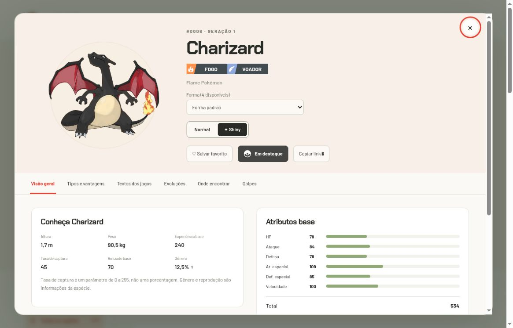

# Formas alternativas e aparência shiny

[Início](../../../README.md) · [Guia de uso](../README.md) · [Identidades dos dados](../../dados/README.md)

## Espécie, variedade e forma

- **Espécie:** identidade nacional, como Charizard (#0006).
- **Variedade:** conjunto próprio de dimensões, atributos, tipos, habilidades e aprendizado, como Mega Charizard X.
- **Forma:** entrada selecionável; pode representar uma variedade distinta ou apenas uma aparência, como uma letra de Unown.

As 1.579 formas incluem a forma padrão de cada espécie. **Não são 1.579 formas adicionais às 1.025 espécies.** Megas, regionais, Gigantamax e outras aparências dependem do cadastro da revisão da fonte utilizada.

## Como selecionar

Ative **Incluir formas** no catálogo para ver entradas adicionais. Dentro da ficha, o campo **Forma** permite trocar entre as formas daquela espécie. A aplicação indica quando se trata de uma forma de batalha. Transformações temporárias aparecem nesse seletor, não como etapas permanentes da família evolutiva.

## Normal e Shiny

Ative **✦ Shiny** ao lado dos filtros ou escolha **Normal / ✦ Shiny** na ficha. A escolha afeta catálogo, destaque, ficha e imagens das evoluções. É possível alternar sem perder a forma ou a aba selecionada.

*Captura histórica de Charizard padrão em shiny; controles e símbolos podem diferir da interface atual. Shiny preserva os tipos Fogo/Voador e os atributos base, com outra coloração.*

Shiny é uma preferência visual: não duplica o catálogo nem cria outro favorito. O link da página conserva a escolha por `shiny=1`. Ver uma imagem shiny não garante que essa aparência seja obtível em determinado jogo ou evento.

## Se uma imagem não existir

| Situação | Comportamento |
| --- | --- |
| Ilustração normal ou shiny disponível | Exibe a ilustração correspondente à variedade |
| Ilustração ausente | Tenta o sprite da mesma aparência |
| Sprite shiny também ausente | Exibe **Imagem shiny indisponível**, sem trocar silenciosamente para normal |
| Forma cosmética, como Unown B | Consulta o sprite específico da forma |
| Forma cosmética sem sprite normal | Identifica a imagem de referência da variedade |
| Forma cosmética sem sprite shiny | Exibe aviso de indisponibilidade |

As imagens e os metadados de sprites vêm de serviços externos; atributos e descrições vêm dos arquivos do projeto. Uma falha de imagem não deve ser confundida com ausência de dados da espécie.

**Código relacionado:** [resolução e cache de imagens](../../../web/js/data.js) · [testes de imagens](../../../tests/images.test.mjs).
